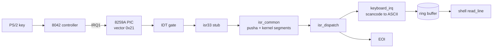

# bnOS

Minimal 32-bit x86 kernel: Multiboot v1 boot, GDT, IDT + 8259A PIC, PS/2
keyboard, bitmap physical memory manager, identity paging with page-level
map/unmap, VGA text console and a mini shell. No libc, no external runtime.

## Build and run

```sh
make            # builds build/kernel.elf
make run        # qemu-system-i386 -kernel build/kernel.elf
make clean
```

Requirements: `gcc` with 32-bit support (`-m32`), `ld`, `qemu-system-i386`.

The image is a Multiboot ELF, so GRUB can boot it as well:

```
multiboot /boot/kernel.elf
```

## Layout

```
src/boot.S        Multiboot header, stack, .bss zeroing, call kernel_main
src/gdt.c/.h      flat 4 GiB kernel code (0x08) and data (0x10) descriptors
src/gdt_flush.S   lgdt + far jump + segment reload
src/idt.c/.h      256-entry IDT, exception reporting, IRQ handler table
src/isr.S         48 interrupt stubs + common frame + iret
src/pic.c/.h      8259A remap to 0x20..0x2F, mask/unmask, EOI
src/keyboard.c/.h PS/2 set-1 decoder (shift/caps), IRQ1 ring buffer
src/pmm.c/.h      physical frame allocator (4 KiB bitmap over 4 GiB)
src/paging.c/.h   page directory/tables, identity map, map/unmap, CR3/CR0.PG
src/shell.c/.h    line editing, tokenizer, command table
src/lib.c/.h      memset/memcpy/memmove/str* (freestanding replacements)
src/vga.c/.h      VGA text driver: clear, scroll, cursor, colors, printf
src/io.h          port I/O and interrupt helpers
linker.ld         ELF32 at 1 MiB, .multiboot first
```

## Boot flow

1. `_start` saves the Multiboot magic/info in `%edx`/`%esi`, zeroes `.bss`,
   then calls `kernel_main(magic, info)`.
2. `gdt_init` loads the flat GDT and reloads `CS`, `DS`, `ES`, `FS`, `GS`, `SS`.
3. `idt_init` installs 48 gates (vectors 0..47). Unused vectors stay
   not-present, so an unexpected interrupt raises #GP and is reported.
4. `pic_remap` moves IRQs to 0x20..0x2F and masks everything.
5. `keyboard_init` registers the IRQ1 handler and drains the controller.
6. `pmm_init` sizes the bitmap from the Multiboot memory map, frees available
   ranges, then reserves low 1 MiB, the kernel image (including its bitmaps),
   the Multiboot info structure, the memory map and the command line.
7. `paging_init` allocates page tables (as permanently reserved frames) and
   identity maps low memory, the kernel and every frame the PMM manages, then
   loads CR3 and sets `CR0.PG`.
8. IRQ1 is unmasked, `sti` runs, and the shell blocks on `hlt` between keys.

## Interrupt path



Exceptions (vectors 0..31) print the vector, name, error code and `eip`, then
halt. IRQs without a registered handler are acknowledged and ignored.

## Memory manager

`pmm.c` uses two 128 KiB bitmaps (used frames and frames handed out by
`pmm_alloc_page`) covering the full 32-bit physical range:

- frame size 4 KiB, max 1,048,576 frames (4 GiB);
- reserved: 0..1 MiB, kernel image + bitmaps, Multiboot structures;
- `pmm_free_page` only accepts frames previously returned by `pmm_alloc_page`,
  so reserved memory cannot be freed from the shell;
- paging is enabled with an identity map, so every managed frame stays
  reachable at its physical address (see below).

## Paging

Legacy 32-bit paging is enabled after the PMM is ready:

- 1024-entry page directory (4 KiB aligned, in `.bss`), 1024-entry page tables,
  4 KiB pages;
- identity mapping of low 1 MiB, the kernel image and all physical memory the
  PMM manages, so every PMM frame remains reachable at its physical address;
- page tables are allocated with `pmm_alloc_kernel_page`, which reserves them
  permanently (the shell cannot free them);
- `paging_map_page`/`paging_unmap_page` map arbitrary virtual addresses and
  flush the TLB with `invlpg`; `vmtest` maps a frame at `0xC0000000`, writes,
  reads back, unmaps and frees it;
- page faults (vector 14) report CR2 plus the error bits (present/write/user/
  reserved/instruction-fetch) and halt;
- this is identity mapping, not demand paging: there is no virtual allocator,
  swapping or copy-on-write.

## Shell commands

| Command | Action |
|---|---|
| `help` | list commands |
| `clear` | clear the screen |
| `echo <args>` | print arguments |
| `mem` | frame totals (4 KiB each) and MiB |
| `paging` | CR3, mapped pages and paging state |
| `vmtest` | non-identity map/write/read/unmap test at `0xC0000000` |
| `alloc` | allocate one 4 KiB frame, remember it |
| `free [addr]` | free the remembered frame or an explicit address |
| `about` | build/subsystem information |
| `halt` | stop the CPU |

Line editing supports printable ASCII, backspace and Enter; the keyboard
driver handles both Shift keys and Caps Lock. Arrow/Delete extended keys are
ignored.

## Documentation

A step-by-step source walkthrough lives in [`docs/`](docs/README.md), with one
document per subsystem and an end-to-end boot/interrupt/command trace.
